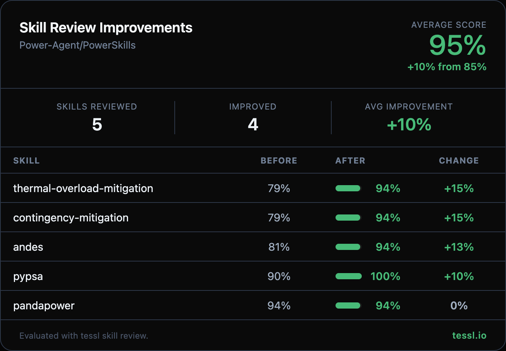

Hey @qian-harvard 👋

I ran your skills through `tessl skill review` at work and found some targeted improvements. Here's the full before/after:

| Skill | Before | After | Change |
|-------|--------|-------|--------|
| thermal-overload-mitigation | 79% | 94% | +15% |
| contingency-mitigation | 79% | 94% | +15% |
| andes | 81% | 94% | +13% |
| pypsa | 90% | 100% | +10% |
| pandapower | 94% | 94% | +0% |

What changed

**Description improvements (andes, thermal-overload-mitigation, contingency-mitigation):**
- Replaced abstract "progressive-disclosure workflow" framing with concrete action verbs (e.g. "sets up and runs power-flow cases, performs eigenvalue analysis")
- Added natural trigger term synonyms power engineers actually use — "load flow", "transient stability", "N-1 violations", "MVA ratings", "congestion", "security analysis", "remedial action schemes"
- Ensured descriptions use standard quoted-string YAML format

**Content improvements (all 5 skills):**
- Added concrete worked examples with realistic parameters and expected outputs (e.g. PTDF sensitivities, MW redispatch values, voltage/loading results)
- Integrated explicit feedback loops into mitigation workflows ("re-solve and verify; if not relieved, proceed to next step")
- Converted plain-text skill references to proper markdown links for better navigation between related skills
- Added inline result-checking hints (e.g. `net.res_bus.vm_pu`, `net.res_line.loading_percent`) for pandapower

I kept this PR focused on the 5 skills with the biggest improvement opportunities to keep the diff reviewable. Happy to follow up with the rest in a separate PR if you'd like.

Honest disclosure — I work at @tesslio where we build tooling around skills like these. Not a pitch — just saw room for improvement and wanted to contribute.

Want to self-improve your skills? Just point your agent (Claude Code, Codex, etc.) at [this Tessl guide](https://docs.tessl.io/evaluate/optimize-a-skill-using-best-practices) and ask it to optimize your skill. Ping me — [@yogesh-tessl](https://github.com/yogesh-tessl) — if you hit any snags.

Thanks in advance 🙏
